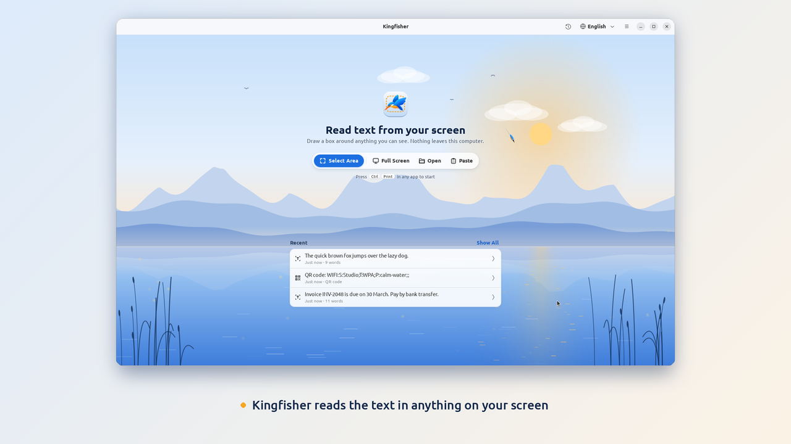
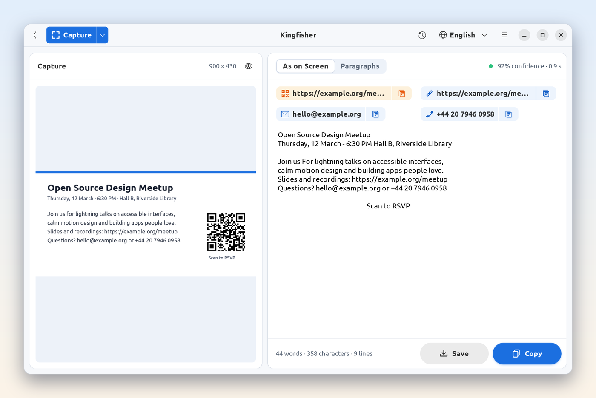
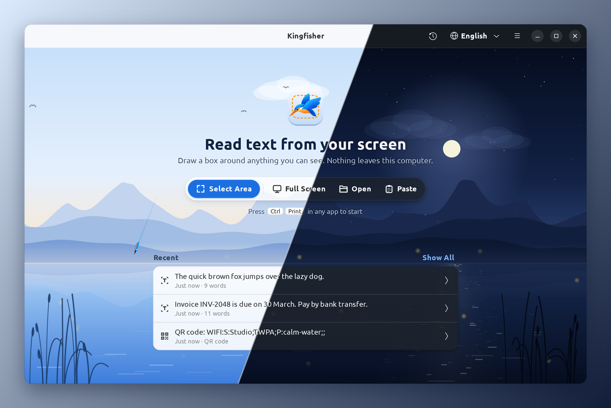
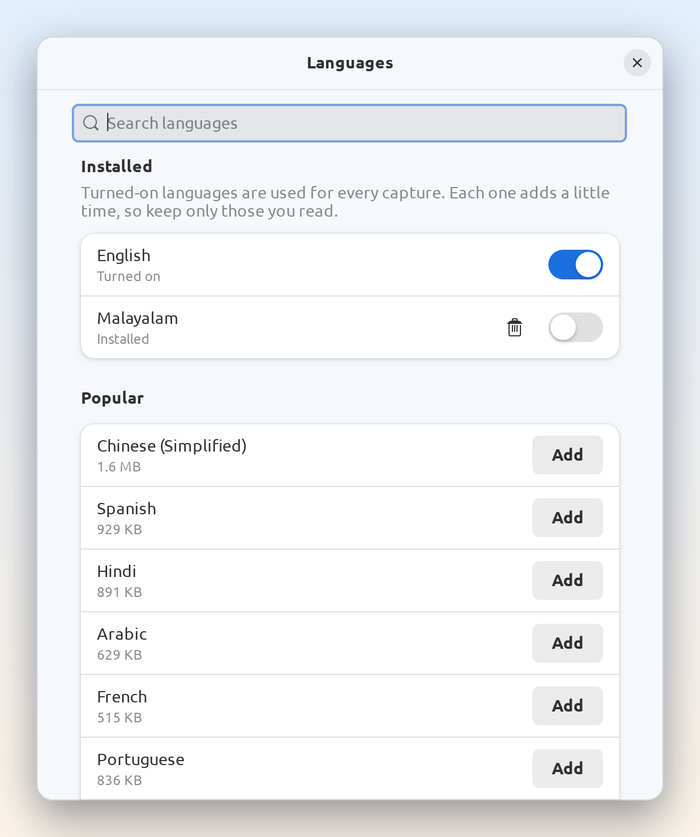
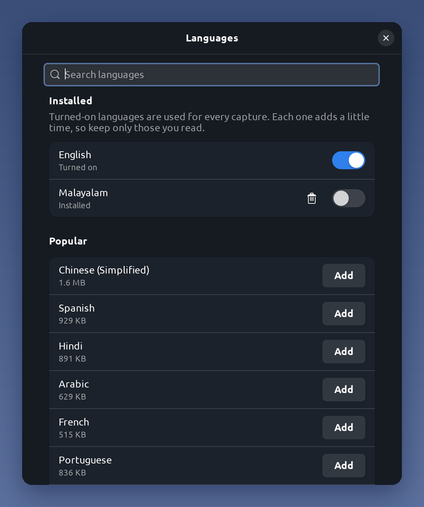

<p align="center">
  
  
</p>

<div align="center">

**Dive into your screen, come up with text.**

<a href="https://snapcraft.io/kingfisher#gh-light-mode-only"></a>
<a href="https://snapcraft.io/kingfisher#gh-dark-mode-only"></a>

[Install](#install) · [Features](#features) · [Usage](#usage) · [Languages](#languages) · [Privacy](#privacy) · [Development](#development)

[](https://snapcraft.io/kingfisher)
[](https://github.com/geojoseph19/kingfisher/actions/workflows/ci.yml)
[](LICENSE)


</div>

Kingfisher reads the text in anything you can see: a video, a photo, a scanned PDF, an error message. Press a shortcut, select the text, and it is on your clipboard, ready to paste. Everything happens on your computer.

<p align="center">
  <picture>
    <source srcset="docs/demo.webp" type="image/webp">
    
  </picture>
</p>

## Highlights

### Select anything

<p align="center">
  
</p>

Press <kbd>Ctrl</kbd>+<kbd>PrtSc</kbd> or your own shortcut. The screen freezes so you can draw a box around exactly what you need, on any monitor. Press <kbd>Enter</kbd> to read it.

### Text, links and codes

<p align="center">
  
</p>

The text is copied as soon as it is read. Links, email addresses, phone numbers and QR codes become buttons you can open or copy. Keep the original layout with **As on Screen**, or join wrapped lines with **Paragraphs**.

### Light and dark

<p align="center">
  
</p>

Kingfisher follows your system's light or dark style, or lets you choose one.

### More than 120 languages

<table>
  <tr>
    <td width="50%"></td>
    <td width="50%"></td>
  </tr>
</table>

Add the languages you read from the Languages window. Your system's languages are listed first.

## Features

- **Select any area** with precise handles, the arrow keys and an optional magnifier. Kingfisher remembers your last selection.
- **Read the whole screen**, image files, images on the clipboard, or images dropped onto the window.
- **Made for screen text**, including small text and light text on dark backgrounds.
- **Keep the layout or join lines.** **As on Screen** keeps columns and indentation. **Paragraphs** joins wrapped lines into readable text.
- **QR codes and barcodes** are read along with the text.
- **Open links, emails and phone numbers** with a single click.
- **See how sure Kingfisher is** with the confidence indicator, and highlight each recognized word.
- **History** of your last 20 results, saved as text only. Turn it off or clear it at any time.
- **Always at hand** from a keyboard shortcut or the top bar. Choose whether a capture opens the window or copies the text right away.
- **Private.** Text recognition happens entirely on your computer.

## Install

### Snap Store

Find Kingfisher in Ubuntu's App Center or on [its Snap Store page](https://snapcraft.io/kingfisher), or run:

```bash
sudo snap install kingfisher
```

The snap includes English and 20 other languages. It runs in a sandbox, so three things work differently:

- **Keyboard shortcut.** The snap can't change system settings. Open **Settings › Keyboard › View and Customize Shortcuts › Custom Shortcuts**, add one, and use `kingfisher --capture` as the command.
- **Screen access.** GNOME asks once for permission, the first time you capture. See [Screen access](#screen-access).
- **Files outside your home folder.** To open images on USB drives and other mounted disks, run `sudo snap connect kingfisher:removable-media` once.

High-accuracy models go in `~/snap/kingfisher/common/tessdata`.

### Ubuntu package

Download `kingfisher_<version>_all.deb` from the [Releases page](https://github.com/geojoseph19/kingfisher/releases) and install it:

```bash
sudo apt install ./kingfisher_*_all.deb
```

### From source

Kingfisher needs Ubuntu 22.04 or later, or another GNOME desktop, with Python 3.10, GTK 4, libadwaita 1.1, PyGObject, Pillow, Tesseract 4.1, `gnome-screenshot` and `python3-pyzbar`. The installer offers to install anything that is missing.

```bash
./install.sh --shortcut --desktop-icon
```

| Option | Effect |
|---|---|
| `--shortcut` | Sets <kbd>Super</kbd>+<kbd>Shift</kbd>+<kbd>T</kbd> as the shortcut. You can change it in Preferences. |
| `--desktop-icon` | Adds a launcher to the desktop. |
| `--best-models` | Downloads the high-accuracy English model (about 15 MB). |
| `--yes` | Runs without questions. |

To try Kingfisher without installing it, run `./bin/kingfisher`.

For the top-bar icon, enable the **Ubuntu AppIndicators** extension, which Ubuntu includes. On other desktops, install the AppIndicator extension and `gir1.2-dbusmenu-glib-0.4`.

### Uninstall

If you set a keyboard shortcut or turned on **Start at login**, turn them off in Preferences first. Then:

- Snap: `sudo snap remove --purge kingfisher` removes it with its settings and history. Without `--purge`, snapd keeps a copy of them for 31 days. A shortcut you added in Settings stays there until you remove it.
- Ubuntu package: `sudo apt remove kingfisher`
- From source: `./uninstall.sh`, or `./uninstall.sh --purge` to also remove your settings, history and downloaded models

## Usage

| Action | How |
|---|---|
| Select an area | Your shortcut, the top-bar icon, **Select Area**, or <kbd>Ctrl</kbd>+<kbd>N</kbd> |
| Read the whole screen | **Full Screen**, <kbd>Ctrl</kbd>+<kbd>Shift</kbd>+<kbd>N</kbd>, or <kbd>C</kbd> while selecting |
| Read the selection or cancel | <kbd>Enter</kbd> or **Extract Text** / <kbd>Esc</kbd> |
| Adjust the selection | Drag the handles, or use the arrow keys (<kbd>Shift</kbd> for larger steps, <kbd>Alt</kbd> to resize) |
| Copy the text | <kbd>Ctrl</kbd>+<kbd>Shift</kbd>+<kbd>C</kbd> |
| Save as a text file | <kbd>Ctrl</kbd>+<kbd>S</kbd> |
| Open or paste an image | <kbd>Ctrl</kbd>+<kbd>O</kbd> / <kbd>Ctrl</kbd>+<kbd>Shift</kbd>+<kbd>V</kbd> |
| History / back | <kbd>Ctrl</kbd>+<kbd>H</kbd> / <kbd>Alt</kbd>+<kbd>←</kbd> |
| Languages | <kbd>Ctrl</kbd>+<kbd>L</kbd> |
| All keyboard shortcuts | <kbd>Ctrl</kbd>+<kbd>?</kbd> |

From the command line:

```
kingfisher                         open the window
kingfisher --capture               select an area
kingfisher --full                  read the whole screen
kingfisher --background            start with only the top-bar icon
kingfisher image.png               read an image file
kingfisher --enable-shortcut [--shortcut-key '<Ctrl>Print']
kingfisher --disable-shortcut
kingfisher --version
```

## Languages

English is included. To add another language, press <kbd>Ctrl</kbd>+<kbd>L</kbd> or choose **Add Languages…** in the language menu, click **Add** and enter your password. Languages are installed as regular Ubuntu packages and are updated with the rest of your system. Remove a language the same way.

Turn on only the languages you need: each one makes reading a little slower.

## Accuracy tips

- Select only the text you need. Leaving out toolbars and icons gives cleaner results.
- For scattered labels, such as the controls of an app, set **Preferences › Page layout** to **Sparse text**. For a single line, choose **Single line**.
- Keep **Enhance small text** turned on.
- For difficult text, install the high-accuracy English model and choose it in **Preferences › Recognition model**. It is about three times slower.
  - From source: `./install.sh --best-models`
  - Otherwise: save [`eng.traineddata` from tessdata_best 4.1.0](https://github.com/tesseract-ocr/tessdata_best/raw/4.1.0/eng.traineddata) in the folder that **Preferences › Engine › Open Folder** opens.

## Troubleshooting

| Problem | Solution |
|---|---|
| A "Share this screenshot?" dialog appears on every capture | Ubuntu package: install `gnome-screenshot`. Snap: see [Screen access](#screen-access). |
| Snap: "Kingfisher can't read files in …" | The file is outside the sandbox. For USB drives and mounted disks, run `sudo snap connect kingfisher:removable-media`. Otherwise choose it with **Open Image**, or copy it into your home folder. |
| The top-bar icon is missing | Enable the **Ubuntu AppIndicators** extension in the Extensions app. |
| Kingfisher says a component is missing | Click **Install** on that page. |
| A key doesn't work as a shortcut | Some laptop keys send nothing in their media layer. Use them with <kbd>Fn</kbd>, or choose another key. The shortcut recorder in Preferences shows what each key sends. |

### Screen access

The Ubuntu package captures through `gnome-screenshot`, which GNOME lets take screenshots without asking.

The snap runs in a sandbox, so GNOME asks you once, the first time you capture:

- **Ubuntu 24.04 and later:** "Allow Kingfisher to Take Screenshots?" Choose **Allow**. To change your answer later, run the command below and capture again.

  ```bash
  gdbus call --session --dest org.freedesktop.impl.portal.PermissionStore \
    --object-path /org/freedesktop/impl/portal/PermissionStore \
    --method org.freedesktop.impl.portal.PermissionStore.DeletePermission \
    screenshot screenshot snap.kingfisher
  ```

- **Ubuntu 22.04:** a screen-sharing dialog. Select your screen (all of them, if you have several), turn on **Remember this selection** and choose **Share**. Kingfisher then reads the screen for a moment at each capture, without asking again. GNOME may show its screen-sharing indicator briefly. To withdraw the permission, choose **Preferences › Screen Access › Forget**. If you connect a different monitor, GNOME asks again once.
- **Xorg sessions** ("Ubuntu on Xorg"): no permission is needed.

Kingfisher reads the screen only when you start a capture, and the picture never leaves your computer.

## Privacy

- Text recognition runs on your computer. Kingfisher makes no network connections and collects no data.
- Screenshots are deleted as soon as they are read, and no images are kept.
- The history keeps text only, is readable only by you, and can be turned off or cleared.
- Links, email addresses and phone numbers open only when you click them.
- New languages are installed through Ubuntu's software system. The high-accuracy model is downloaded only if you ask the installer for it.

Kingfisher stores its settings in `~/.config/kingfisher` and its history in `~/.local/share/kingfisher`.

## Development

```
kingfisher/
  __init__.py          app ID, name, version and paths
  __main__.py          entry point (selects the XWayland backend)
  application.py       command line, capture flow, recognition jobs, actions, tray
  capture.py           capture through gnome-screenshot, with a portal fallback
  overlay.py           the frozen-screen selection
  ocr.py               Tesseract engine, image preparation and layout rebuilding
  codes.py             QR code and barcode reading (ZBar)
  detect.py            link, email address and phone number detection
  window.py            main window
  horizon.py           start page layout
  start_icon.py        start page icon
  scene.py             lake background on the start and reading pages
  effects.py           animation timing, scan line and animated button icons
  preferences.py       preferences and the shortcut recorder
  languages.py         language packs through PackageKit
  language_window.py   the Languages window
  install_button.py    one-click install of optional components
  history.py           history of recent results
  settings.py          settings file
  shortcut.py          GNOME custom shortcuts
  tray.py              top-bar icon (StatusNotifierItem)
  autostart.py         start at login
  geometry.py          monitor and screenshot coordinates
  clipboard.py         clipboard helpers
  toasts.py            in-app notifications
  data/                stylesheets, icons and the keyboard shortcuts window
bin/kingfisher         launcher for source, per-user and system installs
packaging/             desktop entry and AppStream templates, build-deb.sh
tests/                 unit tests (unittest)
```

Run the tests with:

```bash
python3 -s -m unittest discover -s tests -t .
```

The tests need no network and no display. See [CONTRIBUTING.md](CONTRIBUTING.md) for code checks, packaging and releases.

Kingfisher runs its windows through XWayland, because GNOME on Wayland does not raise new full-screen windows from background apps. Set `KINGFISHER_BACKEND=wayland` to run natively instead.

## License

Copyright © 2026 Geo Joseph.

Kingfisher is free software: you can redistribute it and/or modify it under the terms of the GNU General Public License as published by the Free Software Foundation, either version 3 of the License, or (at your option) any later version. It is distributed in the hope that it will be useful, but without any warranty. See [LICENSE](LICENSE) for the full text.

### Trademarks

The Kingfisher name and logo are trademarks. As permitted by section 7(e) of the GNU General Public License, the license does not grant rights to use them. See [TRADEMARKS.md](TRADEMARKS.md).
